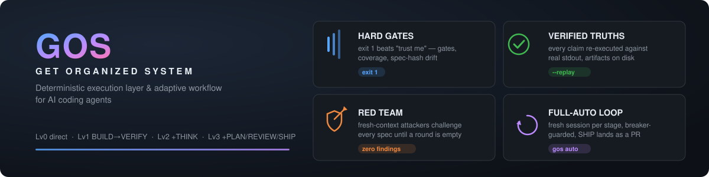

# GOS — Get Organized System

[English](README.md) | [简体中文](README.zh-CN.md)

<p align="center">
  
</p>

<p align="center">

[](https://github.com/chenw521/GOS/actions/workflows/ci.yml)
[](LICENSE)
[](https://github.com/chenw521/GOS/releases/tag/v1.0.0)

</p>

> **AI 编程代理的确定性执行层 + 自适应工作流。**
> 小任务零负担直过；大项目全治理 + 对抗验证。
> 次旗舰模型得到一副跳不掉的能力外骨骼；旗舰模型得到一个哄不动的挑战者。

## 为什么需要 GOS

AI 编程代理以两种相反的方式失败：

- **次旗舰模型**（flash 级、开源系）：跳步骤、没有证据就说"做完了"、跨会话失忆、幻觉命令。跟它说"仔细点"没有用——它需要**硬门**（exit 1）、**文件系统证据**（伪造不了）、**预计算的下一步**（迷不了路）。
- **旗舰模型**：它不缺规则，缺的是**挑战**。写 spec 的模型自审 spec 什么也审不出来。GOS 派出全新上下文的对抗攻击者（有人力时用*不同的模型*），直到某一轮零发现为止。
- **所有人**：改个错字走重流程是税，做个功能零流程是赌。流程重量必须随任务大小伸缩。

GOS 是一个**独立、零依赖**的系统，独立覆盖以上全部——从对
[Superpowers](https://github.com/obra/superpowers)、GSD、OpenSpec
的系统性分析中提炼出三层架构 + 确定性 CLI。GOS 不依赖、不调用、也不要求安装它们中的任何一个。

## 实证

- **自举**：GOS 用 GOS 开发。本仓库自身就是一个 Lv4 项目——20+ 任务/phase 走完整管线（THINK → PLAN → BUILD → REVIEW → VERIFY → SHIP）交付，积累 70+ 条项目教训，每个发版都能追溯到它的决策与已验证真值。回归套件——106 个 section、3300+ 条活断言——就是 CI 主干。
- **基准测试重建中**：外部任务套件基准正在针对当前版本重建；早期数据随被测版本一起退役。方法站得住时公布数字。

## 工作原理

### 基线环——哪怕改个错字也常开

```
INTENT (对齐) → [自适应中段] → VERIFY (证明) → TRACE (记录)
```

### 自适应路由——只为任务需要买单

| 级别 | 任务 | 流程 |
|:---|:---|:---|
| Lv0 | 错字、注释 | 直接执行 |
| Lv1 | 小 bug | BUILD → VERIFY |
| Lv2 | 清晰的小功能 | THINK → BUILD → VERIFY |
| Lv3 | 新功能 | THINK → PLAN → BUILD → REVIEW → VERIFY → SHIP |
| Lv4 | 大项目 | phase 生命周期：claim → 完整 Lv3 → archive → 下一个 |

代理推荐级别；你一句话即可否决。

### 三层一体

| 层 | 级别 | 职责 |
|:---|:---|:---|
| 工程师 | Lv0–Lv2 | 直接执行、TDD、系统化调试、小步并行构建 |
| 设计师 | Lv3 | THINK → PLAN → BUILD → REVIEW → VERIFY → SHIP，产物过门 |
| 总设计师 | Lv4 | PROJECT/ROADMAP/DECISIONS 生命周期，phase claim → 完整 Lv3 → archive |

### 确定性层——让约定真正落地

一个零依赖的 Node CLI（`gos`，Node ≥ 20）把工作流承诺变成机械事实：

- **硬门**：`gos gate all` 对未覆盖的决策、未验证的真值、未声明的文件 diff、spec-hash 漂移直接 exit 1——skill 按这些裁决路由。
- **文件系统兜底**："做完了"没有产物不算数；已验证真值要求 `{command, output, artifact}` 证据，`--replay` 重执行命令并从*真实* stdout 取证。
- **语义层**：计划↔决策双向精确覆盖、diff 命中检查、fn 级调用图影响闭合（`gos map closure`）在测试跑之前就告诉你这次改动连带决定了什么。
- **跨会话记忆**：审计链式教训（tracked JSON 真值）、带 supersede 追踪的决策链、跨会话 `gos resume`。

### 默认对抗

THINK 与 PLAN 的产物会被全新上下文的红队轮番攻击（有人力时用异构模型）。每个发现必须有处置——ACCEPT / PARTIAL / REJECT-with-facts / DEFER。盖章式通过是流程违规，不是风格选择。

### Lv4 phase 生命周期（多周项目）

phase 从 roadmap claim，内部跑完整 Lv3，归档回 `project.json`（单一事实源）并渲染 markdown 视图。乱序完成合法（prev-done 门）；有意推迟的 phase 有显式 `parked` 状态，作为里程碑债务保持可见——没有任何东西会无声消失。

## 全自动模式——`gos auto`

全自动消掉"请开下一个会话"税：runner 驱动活动任务逐阶段推进，每个阶段在**全新派生会话**中执行（上下文永不腐烂），直到 **SHIP**——人类重新接管。硬门、决策审计、红队挑战全部保留；被自动化的只有阶段边界交接。

```bash
gos auto on                     # 启用（仅写配置）：profile、熔断 N/K/B、超时
gos auto status                 # 模式、profile、加固层级、宿主矩阵、计数、熔断器
gos auto run                    # 驱动活动任务（每阶段新会话）
gos auto off                    # 停用（--purge 一并删除机器本地存储）
gos auto disposition <runId> --reason "<text>"   # 人类对红/未知 CI 的裁决
```

`run` 要求存在非 SHIP 的活动任务（报错会指引 `gos init`），并拒绝在 main 检出上运行——循环跑在 `auto/<task-id>` 工作分支上，落 main 依然要走 pull request。

### 机器本地信任库

auto 状态（模式、profile、熔断计数、批准章、disposition、运行锁）存放在
`${XDG_DATA_HOME:-~/.local/share}/gos/<repo-id>/` 的机器本地库——永不提交、不会被队友继承。仓库跟踪态只带**哈希与计数**（无会话 id、模型名或输出尾）。库缺失或损坏时**安全失败**为暂停态并给出指引——绝不静默重置。`gos resume` 会报告 auto 模式（熔断时首行提示）但绝不自动拉起，auto 家族拒绝在自身派生会话内运行（`GOS_AUTO_SPAWNED` 标记），工作会话无法把循环重新打开。

### 有证据的委托

阶段批准三路分流：**机械**门自动通过；**委托**的 THINK/PLAN 阶段在派生内提交 PENDING 记录，runner 在外部对照捕获流戳批准——未批准的 PENDING 阻塞下一阶段推进。THINK 委托要求一个**独立只读派生**的红队通过——提示词来自 runner 持有的模板（绝不来自仓库文件）——**连续两次零发现**；任何发现升级为 held。归档与推送永远留给人类。

### 熔断器——什么能叫停失控循环

| 层 | 默认 | 触发条件 |
|:--|:--|:--|
| N——连续失败 | 3 | 同一阶段连续失败 N 次 |
| K——阶段重访 | 5 | 循环重入阶段 K 次（乒乓） |
| B——派生会话数 | 30 | 派生预算耗尽 |

熔断**暂停** auto——配置保留、绝不自动恢复。失败带类别标签（task / env / auth / timeout），环境损坏永远不会伪装成任务失败；外部变更（人类 stage-back、循环中归档、并发受管提交）以报告形式暂停，不计失败。

### 沙箱分级——诚实面对边界

派生会话在能力 profile 下运行——默认 `restricted`，`workspace` / `full` 显式升级。有 bubblewrap 时启动器构建内核级沙箱；没有时**诚实**降级为 **lexical**——status 里明说：

- **网络保持开放。** 没有出口沙箱。
- **模型提供商凭证设计上可读**——派生会话必须调模型。
- **凭证遮蔽只覆盖清单内路径**；清单之外不做隐藏。
- **lexical 层是纵深，不是冗余**——注入式 deny 配置 + 逃逸探测器，不是内核边界。

### 投递——从 SHIP 到 main

GitHub 投递适配器探测通过（origin + `gh` 认证 + CI 在位）时，循环越过 SHIP 继续：推工作分支、开 PR（runner 渲染的正文，worker 控制的字符串只以带标签的引用块出现）、合并前跑 squash-subject lint、然后盯 CI——超时落入 disposition-unknown 等人裁决，红运行直接叫停循环。仓库 git 元数据被视为不可信：remote 在探测时固定（pin）、每次特权 git 调用前重新校验。没有适配器？循环在 SHIP 干净收尾，投递完全人工。

## 快速开始

### 绿地——三步从零

```bash
npm i -g github:chenw521/GOS   # 直接从 GitHub 安装，跟随 main
# npm i -g @chenw521/gos       # npm 公网发布待定——暂不可用
gos setup
```

> ⚠️ **装对包。** 包名是 **`@chenw521/gos`**——它提供的 bin 命令是 `gos`。公共 npm 上已存在一个名为 `gos` 的无关第三方抢注包，装那个包得不到 GOS。

macOS / Linux / Windows 全平台（需要提权的符号链接自动降级为 junction）。Node ≥ 20。重启 AI 助手，问它 *"list your gos skills"* 验证。然后直接描述任务——GOS 自动激活并推荐级别。任何时刻敲 `gos`（无参数）就是状态 + 下一步。

### 棕地——接入既有仓库

仓库已有历史、配置和自己的文件？`gos brownfield` 探测所有相关路径、分类冲突、只播种缺失的部分——是接纳，不是接管。绝不覆盖现有文件（`--overwrite <asset>` 需显式指定；用户自有 hook 依然拒绝）、绝不写 AGENTS.md/CLAUDE.md/GEMINI.md，播种的 hook 保持**休眠**直到 `gos setup --commitlint`。

```bash
gos brownfield          # 接入报告（--json 给机器）
```

## 真正常用的 CLI

两类受众、两份小清单。完整命令面——50+ 条——在 `gos help` 里（由
[`bin/gos.cjs`](bin/gos.cjs) 的 COMMANDS registry 渲染，单一事实源；机器用 `gos help --json`）。

### 给人用的

| 命令 | 作用 |
|:--|:--|
| `gos` | 状态 + 下一步——零记忆入口 |
| `gos init <level> "<intent>"` | 按推荐级别起任务 |
| `gos resume` | 跨会话续接摘要 |
| `gos auto on / run / status` | 全自动循环控制 |
| `gos brownfield` | 把 GOS 接入既有仓库 |
| `gos setup` / `gos doctor` | 安装 skills / 诊断安装 |

### 给机器用的

| 命令 | 作用 |
|:--|:--|
| `gos context <stage>` | 预计算上下文 JSON（文件、决策、真值、门） |
| `gos instructions <stage>` | 当前任务逐阶段指引 |
| `gos next` | 现在该做什么 |
| `gos commit <stage>` | 阶段产物原子提交 + 推进 |
| `gos gate all [--json]` | 硬门；机器可读失败 `{code, verdict, evidence, fix}` |
| `gos help --json` | 全能力发现 |

## 何时用 GOS / 何时不用

| 适合用 GOS…… | 需要斟酌…… |
|:--|:--|
| 日常跑次旗舰/廉价模型干活——它需要那副外骨骼 | 完全信任模型、小型个人脚本不需要治理 |
| 任务大小混杂（错字→功能）、一刀切重流程让你烦 | 每次变更都是大体量 spec 优先、且已有合规流程在管 |
| 想要跨任务记忆：教训、决策、可验证真值跨会话存活 | 只需要一次性答案，不需要工作流 |
| 旗舰 + 大项目：想要工作被挑战，而不只是被管理 | |

GOS 是独立实现——独立运行，不依赖任何其他工作流工具。

## 项目结构

```
GOS/
├── bin/gos.cjs          # 零依赖* CLI：硬门、语义层、原子提交
│                        #   （*唯一依赖：acorn，用于 AST 调用图）
├── skills/              # 8 个薄 skill（路由表 + HARD-GATE）+ 懒加载参考
│   ├── gos-router/      # 入口：评估 → 推荐级别 → 串接阶段
│   ├── gos-project/     # Lv4 总设计师：PROJECT/ROADMAP/DECISIONS 生命周期
│   ├── gos-think/       # 逐灰区对话 + D-NN 决策 + 红队
│   ├── gos-plan/        # 波次 + 决策覆盖 + 修订环
│   ├── gos-build/       # 波次执行 + TDD + 聚合协议
│   ├── gos-review/      # 两阶段：spec 合规 → 代码质量
│   ├── gos-verify/      # 一次一真值 + 没有证据就没发生
│   └── gos-ship/        # 变更记录 + 归档 + 清理扫描
├── templates/           # spec / plan / verify / review / trace 骨架
├── .gos/                # 工作流产物（project/ 跟踪；state.json 本地）
├── .opencode/ .codex/ .claude-plugin/   # 平台适配
└── AGENTS.md            # 路由规则 + 工具映射
```

## 里程碑

2026-10-08 之前的日期从本地开发台账重建（公开 git 历史在 1.0.0-dev 时重建为快照提交）。

| 日期 | 里程碑 |
|:--|:--|
| 2026-08 | v0.1–v0.2——skills、模板、平台适配 |
| 2026-09 | 确定性 CLI 层——硬门、语义检查、真值证据 |
| 2026-09 | Lv4 phase 生命周期，本仓库全程自举 |
| 2026-10 | 边网 codemap 2.0——fn 级调用图、影响闭合 |
| 2026-10-29 | 全自动模式——`gos auto` 循环、熔断器、沙箱派生、投递 |
| 2026-10-30 | v1.0.0 公开发布（GitHub） |
| 待定 | 公共 npm 上架（`@chenw521/gos`） |
| 待定 | 外部任务套件基准重建 |

## 社区

- **贡献**——开 PR 前先读 [CONTRIBUTING.md](CONTRIBUTING.md)（本地绿=CI 绿的命令清单、changelog 义务、AI 参与披露）。
- **变更日志**——[CHANGELOG.md](CHANGELOG.md)（Keep a Changelog 格式；更早历史在 `git log`）。
- **bug 与功能请求**——[issue 表单](https://github.com/chenw521/GOS/issues/new/choose)（bug 报告带 AI 助手 / 模型 / `gos --version` 字段）。

## 许可证

[MIT](LICENSE)
